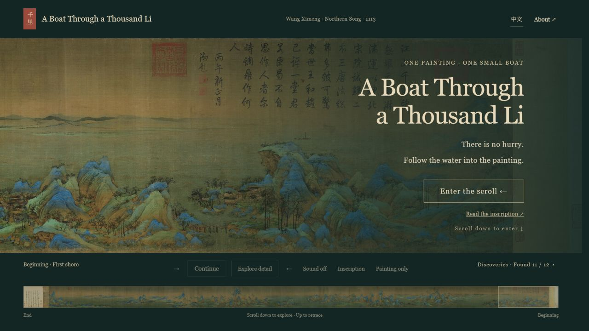

# A Boat Through a Thousand Li

**English** · [简体中文](README.zh-CN.md)

An interactive journey through Wang Ximeng’s *A Thousand Li of Rivers and Mountains*: one original landscape, one small boat, and room to look slowly.

**[Live English demo](https://qianli-boat-journey.rainatwu.chatgpt.site/en/)** · **[中文版 / Chinese demo](https://qianli-boat-journey.rainatwu.chatgpt.site/)**

The demo is public and requires no login. These links open the working experience, not a recording. The hosted demo is published separately from GitHub; pushing to this repository does not automatically update it.



## The core experience

The painting already provides the visual richness. The interface adds movement and interpretation sparingly, so looking at the original remains the main activity.

1. **Enter gently.** Scroll down or select “Enter the scroll.” The title slides to the right and fades, revealing the painting.
2. **Unroll the landscape.** Vertical scrolling advances through the long handscroll from right to left. Reverse the scroll to retrace your journey.
3. **Pause at a detail.** Twelve stops combine six scenic viewpoints with bridge, mooring, ferry, fishing, watermill and waterfall encounters. The camera eases in, a note opens, and further scrolling carries you onward.
4. **Look wherever you want.** Tap an unmarked area to open a local zoom menu. In detail mode, pan and zoom freely. Zooming all the way out reconnects to the scroll journey.
5. **Find the boat’s origin.** Tap the traveling boat for a clue. Find its painted counterpart to unlock the quiet “Boat Seeker” discovery.

The opening inscription can be read on demand. The English version includes an explicitly labeled reading note and the original Chinese verses. There is no spoken narration. Optional synthesized water ambience is off by default.

## Why this technology fits this experience

This is a static HTML, CSS and vanilla JavaScript application. There is no framework, application server, database or package-install step.

| Choice | How it supports the experience | Trade-off |
| --- | --- | --- |
| Camera-aware loading of 20 JPEG tiles | A small overview stays visible while current-view tiles and nearby detail load, with two requests at a time. Failed details can be retried without blocking entry. | This is not a multi-resolution pyramid. Offscreen ready images are evicted toward a six-tile resident budget; visible/prefetched tiles are retained even if that budget is exceeded. Browser caches and decoded-memory reclamation are browser-managed. |
| Native document scrolling mapped to a camera timeline | A familiar gesture drives travel, zoom-in, pause and zoom-out phases. Backward scrolling naturally revisits the scene. | Distance is choreographed rather than a literal one-to-one horizontal scrollbar. |
| CSS transforms and `requestAnimationFrame` | A single transformed world keeps image details and interactions aligned. Camera easing can be interrupted by direct manipulation. | Smoothness still depends on image decoding, device memory and browser performance; no frame-rate guarantee is claimed. |
| Pointer Events plus touch handling | Mouse dragging and two-finger zoom share the camera model. A movement threshold distinguishes a tap from a drag. | Actual touch hardware still needs cross-browser testing; viewport simulation alone is insufficient. |
| Native HTML buttons and dialogs | Controls remain inspectable, keyboard-operable and labeled, without painting the whole interface into a canvas. | The panoramic artwork itself is visual; this is not a complete nonvisual museum interpretation. |
| CSS responsive layouts and reduced-motion support | Compact controls and bottom annotations suit phones; timed animations are reduced when the system requests it. | Scroll-driven spatial navigation remains part of the experience. |
| Web Audio API | Soft water ambience can be synthesized locally, without a streamed soundtrack or external audio service. | It is an artistic sound treatment, not a field recording. |
| `localStorage` | Discovery progress stays in the visitor’s browser, with no account or backend. | Clearing browser storage resets progress; discoveries do not sync across devices. |
| Generated English entry point | One shared interaction source produces localized English files. Both languages can be served by any static host, without a runtime translation dependency. | After editing shared text or behavior, regenerate the English output. Switching language currently starts at the entrance. |

The important benefit is a close match between the architecture and the interaction: a static painting needs a camera, a timeline and a few meaningful points of interest. A larger application framework would add machinery without being necessary for these features.

## Run locally

Requires Python 3 for a local HTTP server. No dependency installation is needed.

```sh
python -m http.server 8000 --directory dist
```

Open [English](http://localhost:8000/en/) or [Chinese](http://localhost:8000/). Serve over HTTP rather than opening HTML as a local file.

After editing Chinese source strings or interaction code:

```sh
python scripts/build-english.py
node --test tests/image-loader.test.cjs tests/journey.test.cjs
node --check dist/app.js
node --check dist/en/app.js
node --check dist/en/painting-menu.js
node --check dist/en/boat-egg.js
```

Python and Node are development tools here; neither is required by the deployed static website. The generator fails if Chinese text remains in the generated JavaScript. Chinese poetry and the small seal are intentionally retained in the English HTML.

## Project structure

```text
dist/
  index.html           Chinese entry point and semantic interface
  app.js               Scroll timeline, camera, boat routes and scenes
  image-loader.js      Viewport-prioritized loading, retries and image eviction
  painting-menu.js      Tap-versus-drag handling and local zoom menu
  boat-egg.js           Hidden boat discovery
  style.css            Shared layout and motion
  en.css               English typography and responsive adjustments
  en/                  Generated English HTML and scripts
  assets/              Original image, tiles, details and boat sprite
scripts/
  build-english.py      Reproducible English generation
translations-en.txt    English text catalog
tests/                 Dependency-free Node regression tests
docs/
  english-preview.jpg  Actual browser screenshot
```

Deploy the contents of `dist/` to a static host, keeping `en/` and `assets/` in place. The English page uses a relative base URL so assets are shared rather than duplicated. The public GitHub export excludes hosting credentials, deployment metadata, local research files and development screenshots other than the documented preview.

## Image provenance and interpretation

- Artwork: Wang Ximeng, *A Thousand Li of Rivers and Mountains*, 1113, Palace Museum, Beijing.
- Source: [Wikimedia Commons — complete handscroll, public-domain-marked version](https://commons.wikimedia.org/wiki/File:Wang_Ximeng._A_Thousand_Li_of_Rivers_and_Mountains._(Complete,_51,3x1191,5_cm)._1113._Palace_museum,_Beijing.jpg).
- Digital image dimensions: **39,974 × 1,600 pixels**, including mounting, inscriptions and seals.
- Collection information: [Palace Museum](https://www.dpm.org.cn/collection/paint/228354.html).
- Later opening inscription: [Palace Museum transcription](https://www.dpm.org.cn/subject_rivsmounts/qljs/245996.html). It was added by Qianlong centuries after the original painting.

The landscape is not repainted. The moving boat is an **AI-assisted extraction/reconstruction based on a boat beside the long bridge**, not a pixel-exact archival cutout. Boat routes, water sound, the watermill schematic and interactive stories are contemporary interpretations, not claims about historical motion or engineering precision. Source links accompany the relevant notes in the experience.

## License

Original software and documentation are licensed under the **[MIT License](LICENSE)** — Copyright (c) 2026 Tong Wu. You may use, modify, and distribute the licensed software, including commercially, provided the copyright and permission notices are retained. The software is provided without warranty.

Image assets, screenshots, historical artwork and inscriptions, and third-party material are outside this software license. See **[License scope and artwork notices](ASSET_NOTICE.md)** for their sources and status. This exclusion does not impose restrictions on public-domain material.

## Validation and current limits

- Browser checks cover entry, scrolling, annotations, free exploration, zoom-menu placement, inscription dialogs and the hidden boat discovery.
- Responsive checks include small portrait, standard portrait and short landscape viewports. Real-device multi-touch testing remains a follow-up; it is not claimed as completed.
- Entry no longer waits for all 20 tiles. At the checked 390 × 844 portrait viewport, the initial camera requested tiles 17–19; a low-resolution overview remains behind the detail images. Larger viewports may request more tiles. This is a request-scope check, not a measured mobile-network load-time benchmark.
- Twenty-one dependency-free Node tests cover image request ordering/concurrency, retry, eviction, bilingual entry, navigation/annotations, tap-versus-drag, two-pointer state handling, zoom-to-scroll, resize preservation, keyboard access, and discovery persistence. Interaction tests execute the real scripts against a small DOM adapter; they do not emulate browser rendering or native touch behavior.
- Browser QA covered 390 × 844 Chinese portrait, 320 × 568 English portrait, and 844 × 390 landscape. Transport buttons in portrait have 44 px targets, annotations fit above the footer, and no horizontal page overflow was observed. Physical-device pinch/scroll testing remains outstanding.
- The persistent animation loop and full-resolution decoded images can be demanding on low-memory devices. No performance benchmark is implied by the simple stack.
- No analytics, account system or server-side progress storage is included in the application code.

### Touch navigation

On touch devices, swipe left over the painting to advance, or right to return. Reaching a stop starts an 800 ms camera transition automatically; the arrival gesture is consumed. Lift your finger and swipe again after the transition to leave. Swipe right to revisit earlier scenery. Annotation panels scroll independently. Tap the painting to enter free exploration, where one finger pans and two fingers zoom. Desktop wheel navigation remains scroll-driven. Five additional state regressions cover arrival, repeated input during animation, reverse travel, gesture cancellation, pure mode and desktop behavior. Physical iOS/Android touch validation remains outstanding.
